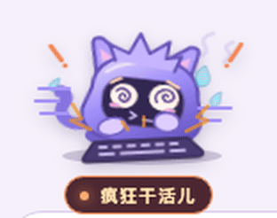

# Codex Workshop Pets

[简体中文](README.md) · **English**

Add a row of tiny pets above the composer in Codex Desktop. The width of the composer determines how many pets fit. When a task starts, the leftmost free pet gets spiral eyes and starts hammering its keyboard. When the task finishes, the pet closes its eyes, takes a breath, and settles back into place. Once all slots are busy, extra tasks are skipped. Each working pet shares a colored shape with its chat. Hover over a pet to highlight the matching chat in the sidebar, or click it to jump there.



## Use it in Codex

You need macOS, the ChatGPT desktop app installed in Applications, and Node.js 22 or later. Open or create a local chat in Codex, then run:

```sh
git clone https://github.com/normalpeople553/codex-workshop-pets.git
cd codex-workshop-pets
./Launch.command
```

You can also double-click `Launch.command` in Finder. When the launcher asks you to quit ChatGPT, switch to the app and press **⌘Q**. The launcher reopens it. Return to any local Codex chat and leave the launcher’s Terminal window open. Send Codex a task to see a pet start working. Start tasks in two local chats to see the two leftmost pets work independently.

Press **Ctrl+C** in the launcher’s Terminal window to hide the pets. To exit demo mode, quit ChatGPT with **⌘Q**, then reopen it from the Dock.

## Design your own pet

1. Open [art/pet.svg](art/pet.svg) and draw your character’s body, expressions, paws, and props. Figma, Inkscape, or a text editor will work.
2. Adjust motion, timing, and colors in [art/pet.css](art/pet.css). Keep the SVG animation class names so the existing animations can find the right parts of your artwork.
3. Run `npm run preview` and open the local address printed in Terminal. Try the idle, working, and finished states, or start two sample tasks together. Refresh the page after editing the artwork.
4. If the desktop demo is running, saving the SVG or CSS updates the pets without restarting the app.

[Design and animate a pet from scratch](docs/design.en.md)

## How it works and what it supports

The bridge reads Codex Desktop chat events and titles locally. Each task takes a clickable pet slot. The pet plays a short finishing animation and returns to idle when the task completes. Canceling a task frees its slot immediately. The current implementation supports local desktop chats. It relies on the local Codex event format and composer layout, so app updates may require changes to event parsing or UI selectors.

The launcher opens a temporary debug port on the loopback interface to draw the pets inside the window. The bridge leaves the app bundle intact and keeps chat content on your machine. The preview uses artwork from this repository and sample task states.

The code and included assets are available under the [Apache License 2.0](LICENSE). In-window rendering was inspired by [Codex Styler](https://github.com/xuhuanstudio/codex-styler). This is an unofficial project and is not affiliated with OpenAI.
