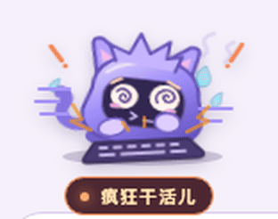

# Codex Workshop Pets

**简体中文** · [English](README.en.md)

给 Codex 派完活，我常常盯着聊天列表里的那个小圆圈。它转了半天，界面上也没什么动静，我就忍不住想，它怎么还没干完？可这时候它可能正在翻文件、改代码，或者跑测试。光看那个圆圈，看不出它有多忙。

所以我在输入框上方摆了一排小工位。Codex 一开工，就有一只小宠物扑到键盘上，敲到炸毛、冒汗，连键帽都飞起来。等任务做完，它才停下爪子，闭着眼松一口气。



输入框有多宽，就摆多少只待机宠物。各个本地项目的任务都会出现在这一排，新任务从最左边的空闲宠物开始分配，排满后跳过超出的任务。宠物和对应聊天有同色同形的小标记，悬停能高亮那条聊天，点击就能跳过去。

开启快速模式的任务，对应的小宠物会敲得更快。

## 在 Codex 里使用

需要 macOS、安装在「应用程序」中的 ChatGPT 桌面端，以及 Node.js 22 或更新版本。先在 Codex 中打开或创建一条本地聊天，再运行下面的命令。

```sh
git clone https://github.com/normalpeople553/codex-workshop-pets.git
cd codex-workshop-pets
./Launch.command
```

也可以在 Finder 双击 `Launch.command`。启动器提示等待时，切回 ChatGPT 按 **⌘Q**，它会重新打开。回到任意本地 Codex 聊天，保留启动器的终端窗口。想测试动作，可以给 Codex 发一条任务。两条本地聊天同时工作时，可以看到最左边的两只各自干活。

结束时在启动器终端按 **Ctrl+C**，宠物会消失。要结束演示模式，按 **⌘Q** 退出 ChatGPT，再从 Dock 正常打开。

## 设计你自己的宠物

1. 打开 [art/pet.svg](art/pet.svg)，画出角色身体、表情、爪子和道具。可以用 Figma、Inkscape 或任意文本编辑器。
2. 在 [art/pet.css](art/pet.css) 调动作、节奏和配色。保留 SVG 里的动作类名，现有动画就会作用到你的新图形。
3. 运行 `npm run preview`，打开终端给出的本地地址。页面可以预览待机、接活、完成，以及两个任务同时开始。改完素材刷新页面即可。
4. 如果桌面演示已经开着，保存 SVG 或 CSS 就会热更新，聊天可以继续开着。

[从空白图形做到会干活的小宠物](docs/design.md)

## 事件和兼容性

桥接在本机读取 Codex 桌面端的聊天事件和标题。每个任务占用一个可点击的宠物位置，任务完成后宠物做收尾动作并回到待机。手动中止会直接释放位置。当前实现针对本地桌面聊天，依赖 Codex 的本地事件格式和输入框结构，应用升级后可能需要更新选择器或事件解析。

启动器只在本机回环地址打开临时调试端口，用来把宠物画进窗口。桥接不改应用包，也不把聊天内容发到网络。预览页只加载仓库里的美术文件，使用示例状态。

代码和随附素材按 [GNU GPL 第 3 版](LICENSE) 分发。对外分发修改版时，须按 GPL-3.0 向接收者提供对应源码。窗口内渲染参考了 [Codex Styler](https://github.com/xuhuanstudio/codex-styler)，上游许可和署名见 [NOTICE](NOTICE)。这是非官方项目，与 OpenAI 无隶属关系。
